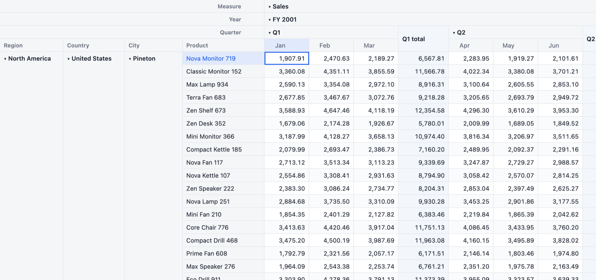

<h1 align="center">BorealJS Grid</h1>

<p align="center">
  A data grid for the web that stays smooth at any size: thousands to <b>billions</b> of rows and up to
  <b>millions</b> of columns.<br/>React or plain JavaScript, data in memory or from any backend.
</p>

<p align="center">
  <a href="https://www.npmjs.com/package/@borealjs/react-grid"></a>
  <a href="https://www.npmjs.com/package/@borealjs/grid-core"></a>
  <a href="https://bundlejs.com/?q=@borealjs/grid-core"></a>
  <a href="https://github.com/borealjs/grid/actions/workflows/ci.yml"></a>
  <a href="LICENSE"></a>
</p>

<p align="center"><b><a href="https://borealjs.github.io/grid/">Live demo</a></b>: a billion-row table, a pivot and React cells, right in your browser.</p>

<picture>
  <source media="(prefers-color-scheme: dark)" srcset="https://raw.githubusercontent.com/borealjs/grid/main/media/grid-dark.png">
  
</picture>

## Features

- **Any size.** Smooth scrolling through billions of rows and millions of columns; only what is on screen is
  loaded.
- **Any data.** An array in memory, or your backend through a few async callbacks (REST, GraphQL, SQL, a
  worker).
- **Sorting and filtering.** Multi-column sort; filters for ranges, dates, text and searchable value lists,
  plus your own.
- **Pivots.** Grouped row and column headers, subtotals, expand and collapse.
- **Spreadsheet feel.** Range selection, copy into Excel or Google Sheets, merged cells, full keyboard support.
- **Yours to shape.** Custom cells, headers, filters and empty state; theme with CSS variables; dark mode;
  translations.
- **Small.** About 34 kB gzipped, no dependencies, TypeScript types included.

## Packages

| Package | For | Guide |
|---|---|---|
| [`@borealjs/react-grid`](https://www.npmjs.com/package/@borealjs/react-grid) | React 18 and 19 | [React guide](packages/react-grid/README.md) |
| [`@borealjs/grid-core`](https://www.npmjs.com/package/@borealjs/grid-core) | plain JavaScript, or any other framework | [JavaScript guide](packages/grid-core/README.md) |

## Quick start: React

```bash
npm install @borealjs/react-grid @borealjs/grid-core
```

```jsx
import { VirtualGrid, Column } from '@borealjs/react-grid';
import '@borealjs/grid-core/style.css';

const customers = [
  { name: 'Ada Lovelace', status: 'Active', amount: 1200 },
  { name: 'Grace Hopper', status: 'Pending', amount: 950 },
  { name: 'Alan Turing', status: 'Active', amount: 1430 },
];

export default function App() {
  return (
    <VirtualGrid rows={customers} style={{ height: 400 }} aria-label="Customers">
      <Column field="name" title="Customer" />
      <Column field="status" title="Status" filter="values" />
      <Column field="amount" title="Amount" type="number" />
    </VirtualGrid>
  );
}
```

## Quick start: JavaScript

```bash
npm install @borealjs/grid-core
```

```html
<div id="grid" style="height: 400px"></div>
```

```js
import { createGrid, createArraySource } from '@borealjs/grid-core';
import '@borealjs/grid-core/style.css';

const customers = [
  { name: 'Ada Lovelace', status: 'Active', amount: 1200 },
  { name: 'Grace Hopper', status: 'Pending', amount: 950 },
];
const columns = [
  { key: 'name', title: 'Customer' },
  { key: 'status', title: 'Status', filter: 'values' },
  { key: 'amount', title: 'Amount', type: 'number' },
];

createGrid(document.getElementById('grid'), {
  dataSource: createArraySource(customers, { columns }),
  columns,
});
```

No build step? Load it from a CDN; see [Without a bundler](packages/grid-core/README.md#without-a-bundler).

## Try the demos

The repository has two demos: a plain JavaScript one with a billion-row table and a pivot, and a React one
with custom cells, filters and a server-backed table.

```bash
git clone https://github.com/borealjs/grid.git && cd grid && npm install
```

```bash
npm start
```

```bash
npm run dev:react
```

`npm start` serves the JavaScript demo at http://localhost:5174. `npm run dev:react` serves the React demo at
http://localhost:5175; keep `npm start` running for its server-data tabs. `npm run build:demo` builds the
static React demo that is published as the [live demo](https://borealjs.github.io/grid/): no server, the
demo backend (`demo-backend.mjs`) runs in the browser.

## Links

- [Releases and changelog](https://github.com/borealjs/grid/releases)
- [Report a bug or ask for a feature](https://github.com/borealjs/grid/issues)
- [Contributing](CONTRIBUTING.md)

## License

[MIT](LICENSE)
