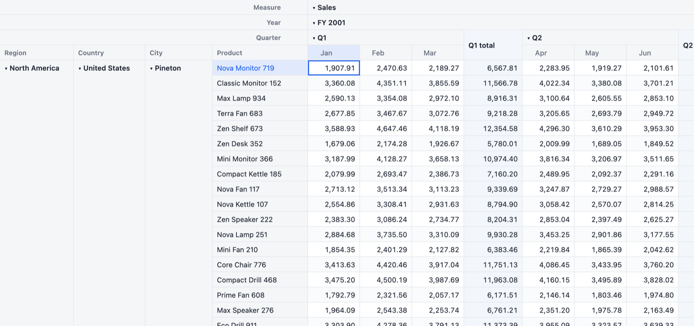

# @borealjs/grid-core

[](https://www.npmjs.com/package/@borealjs/grid-core)
[](https://bundlejs.com/?q=@borealjs/grid-core)
[](https://github.com/borealjs/grid/blob/main/packages/grid-core/index.d.ts)
[](https://github.com/borealjs/grid/blob/main/LICENSE)

A data grid for the web that stays smooth at any size: thousands to billions of rows and up to millions of
columns. Give it an array, or a few async callbacks that read from your backend. Works with plain JavaScript
and any framework; React users want [`@borealjs/react-grid`](https://www.npmjs.com/package/@borealjs/react-grid).

**[Live demo](https://borealjs.github.io/grid/)**: a billion-row table, a pivot and custom cells, right in your browser.

<picture>
  <source media="(prefers-color-scheme: dark)" srcset="https://raw.githubusercontent.com/borealjs/grid/main/media/grid-dark.png">
  
</picture>

- Multi-column sorting; filters for ranges, dates, text, searchable value lists and your own
- Pivots with grouped headers, subtotals, expand and collapse
- Range selection, copy into spreadsheets, merged cells, full keyboard support
- Custom cells, headers, filters and empty state; CSS-variable themes, dark mode, translations
- About 34 kB gzipped, no dependencies, TypeScript types included

## Contents

- [Installation](#installation)
- [Quick start](#quick-start)
- [Without a bundler](#without-a-bundler)
- [Columns and cells](#columns-and-cells)
- [Sorting and filtering](#sorting-and-filtering)
- [Server data](#server-data)
- [Selection and copy](#selection-and-copy)
- [Controlled state](#controlled-state)
- [Styling and theming](#styling-and-theming)
- [Translations](#translations)
- [Pivots](#pivots)
- [Keyboard](#keyboard)
- [API reference](#api-reference)
- [FAQ](#faq)

## Installation

```bash
npm install @borealjs/grid-core
# or
pnpm add @borealjs/grid-core
yarn add @borealjs/grid-core
bun add @borealjs/grid-core
```

Import the styles once in your app:

```js
import '@borealjs/grid-core/style.css';
```

The package is published as ES modules and runs in all current browsers (Chrome, Edge, Firefox, Safari).

## Quick start

**1. Add a container with a height.** The grid fills it.

```html
<div id="grid" style="height: 500px"></div>
```

**2. Describe your columns and create the grid.**

```js
import { createGrid, createArraySource } from '@borealjs/grid-core';
import '@borealjs/grid-core/style.css';

const rows = [
  { id: 1, name: 'Ada Lovelace', status: 'Active', amount: 1200, signed: '2024-03-01' },
  { id: 2, name: 'Grace Hopper', status: 'Pending', amount: 950, signed: '2024-05-17' },
  { id: 3, name: 'Alan Turing', status: 'Active', amount: 1430, signed: '2023-11-30' },
];

const columns = [
  { key: 'id', title: 'ID', type: 'number', width: 80 },
  { key: 'name', title: 'Customer', width: 200 },
  { key: 'status', title: 'Status', filter: 'values' },
  { key: 'amount', title: 'Amount', type: 'number', format: (v) => `$${v.toFixed(2)}` },
  { key: 'signed', title: 'Signed', type: 'date' },
];

const grid = createGrid(document.getElementById('grid'), {
  dataSource: createArraySource(rows, { columns }),
  columns,
  ariaLabel: 'Customers',
  onSortChange: (sort) => console.log(sort), // [{ column: 3, key: 'amount', direction: 'desc' }]
});
```

That grid already sorts (click a header; Shift+click adds a column), filters (the funnel in each header),
resizes columns, selects ranges, copies with ⌘C / Ctrl+C and works from the keyboard.

> **Important**
> The grid takes the size of its container. If nothing shows up, give the container a height, or make it a
> flex child with `flex: 1; min-height: 0`.

## Without a bundler

Load the module and the stylesheet straight from a CDN:

```html
<link rel="stylesheet" href="https://cdn.jsdelivr.net/npm/@borealjs/grid-core@0.1.1/src/grid.css" />
<div id="grid" style="height: 400px"></div>

<script type="module">
  import { createGrid, createArraySource } from 'https://cdn.jsdelivr.net/npm/@borealjs/grid-core@0.1.1/+esm';

  const columns = [{ key: 'name', title: 'Name' }, { key: 'city', title: 'City', filter: 'values' }];
  const rows = [{ name: 'Ada', city: 'London' }, { name: 'Grace', city: 'New York' }];
  createGrid(document.getElementById('grid'), { dataSource: createArraySource(rows, { columns }), columns });
</script>
```

Pin the version in the URL so an update never changes your page unexpectedly.

## Columns and cells

```js
{
  key: 'amount',             // the row field, and the column's id in sort, filter and events
  title: 'Amount',
  type: 'number',            // 'number' aligns right and filters by range; 'date' filters by date range
  width: 120,
  format: (value) => money.format(value),
  cellClass: (value) => (value < 0 ? 'negative' : ''),
}
```

There are three ways to customize a cell, from lightest to most flexible:

| | Use it for |
|---|---|
| `format(value, ctx)` | the text shown: currencies, dates, units |
| `cellClass(value, ctx)` | a CSS class: colors, weights, icons from CSS |
| `renderCell(el, ctx)` | your own elements: badges, links, buttons, progress bars |

```js
renderCell(el, { value, row }) {
  const link = document.createElement('a');
  link.href = `/customers/${row.id}`;
  link.textContent = value;
  el.append(link);
}
```

`renderCell` draws into `el`. If it returns a function, that function runs before the cell shows something
else, so you can clean up (unmount a component, remove a listener). Links, buttons and inputs inside cells
work as usual; mark other clickable elements with `data-vg-interactive`.

All three receive the same context:

| | |
|---|---|
| `value` | the cell's value |
| `row` | the whole record (with `createArraySource`; `undefined` for server data) |
| `text` | the value after `format` |
| `rowIndex`, `colIndex` | position on screen, after sorting and filtering |
| `rowSource`, `colSource` | position in the data source |
| `column` | the column definition |
| `grid` | the [grid API](#grid-methods) |

`renderHeader(el, ctx)` customizes a header the same way, and the `renderEmpty(el, { filtered })` option draws
the empty state. Options with the same names on the grid apply to every column that has none of its own.

For tables with thousands of columns, pass `columnCount` and `getColumn(index)` instead of `columns`. Titles
you leave out are loaded with the data source's `getLabels`.

## Sorting and filtering

Click a header to sort (▲, ▼, off); Shift+click adds it to the sort. Each column gets a filter dialog, chosen
like this:

1. The column's `filter` decides when it is set:

   | `filter` | Dialog |
   |---|---|
   | `'values'` | checkbox list with search |
   | `{ type: 'values', values: [...] }` | checkbox list of the values you give |
   | `'text'` | "contains" |
   | `'number'`, `'date'` | min and max, from and to |
   | `{ op, render }` | your own ([custom filters](#custom-filters)) |
   | `false` | no filter |

2. Otherwise the column's `type` decides: `'number'` gets a number range, `'date'` a date range, anything else
   a text search.
3. A value list shows the values you pass, or asks the data source (`getFilterValues`). At most 1,000 are
   listed; beyond that the dialog asks the user to refine the search. A data source without
   `getFilterValues` gets a text search instead.

Value lists suit columns with a modest set of repeated values (status, city, owner); text search suits
near-unique ones (names, codes).

### Custom filters

```js
{
  key: 'score',
  type: 'number',
  filter: {
    op: 'atLeast',
    render(el, api) {
      const input = Object.assign(document.createElement('input'), { type: 'range', value: api.value ?? 50 });
      input.oninput = () => api.setValue(Number(input.value)); // the dialog's Apply button sends it
      el.append(input);
    },
  },
}

// With in-memory rows, say what the operator means:
createArraySource(rows, { columns, filterFns: { atLeast: (cellValue, min) => cellValue >= min } });
```

`api` has `value`, `setValue(value)`, `apply(value?)`, `clear()`, `close()`, `column` and `title`. A server
receives `{ key: 'score', op: 'atLeast', value: 72 }` in the query's filter list.

## Server data

A data source is an object with async callbacks. Only `getCells` is required. The grid asks only for what is
on screen, and every call gets an `AbortSignal`: pass it to `fetch` so requests the grid no longer needs are
cancelled.

```js
const dataSource = {
  // How many rows match the current filter.
  async getLayout({ query, signal }) {
    const res = await fetch(`/api/orders/count?q=${encodeURIComponent(JSON.stringify(query))}`, { signal });
    return { rowCount: (await res.json()).count };
  },

  // The cells of one or more rectangles.
  async getCells({ rects, query, signal }) {
    const res = await fetch('/api/orders/cells', {
      method: 'POST',
      headers: { 'Content-Type': 'application/json' },
      body: JSON.stringify({ rects, query }),
      signal,
    });
    return (await res.json()).cells; // one entry per rect: [[a, b], [c, d]]
  },

  // Optional: values for value-list filters.
  async getFilterValues({ key, search, limit, signal }) {
    const res = await fetch(`/api/orders/values?field=${key}&q=${encodeURIComponent(search)}&limit=${limit}`, { signal });
    return res.json(); // { values: ['Lamp', 'Desk', …], total: 3120, matches: 41 }
  },
};

createGrid(el, { dataSource, columns });
```

A rect is `{ row, col, rowCount, colCount }`. Rows are positions in the sorted and filtered result; columns
are column indexes. Answer each rect with its rows of values (`[[a, b], [c, d]]`) or one flat row-major
array (`[a, b, c, d]`).

The query describes the current sort and filters:

```js
{
  sort: [{ column: 3, key: 'amount', direction: 'desc' }],
  filter: [
    { column: 3, key: 'amount', op: 'range', min: 0, max: 100 },   // numbers, or dates as 'YYYY-MM-DD'
    { column: 2, key: 'status', op: 'in', values: ['Open'] },      // also 'notin'
    { column: 1, key: 'name', op: 'contains', text: 'ada' },
    { column: 7, key: 'score', op: 'atLeast', value: 90 },         // custom filters
  ],
  columnFilter: [],                                                 // which column groups are shown
}
```

With SQL, `filter` becomes a parameterized `WHERE`, `sort` becomes `ORDER BY` (add a unique column last so the
order is stable), and a rect becomes rows `row` to `row + rowCount - 1` of that order. Map `key` to column
names through an allow-list on the server; never put client text into SQL.

If your backend can't sort or filter very large tables, return `maxSortRows` / `maxFilterRows` from
`getLayout`. The grid then explains the limit to the user instead of sending requests that would fail.

### Ready-made sources

- **`createArraySource(rows, options)`** sorts, filters and searches rows in memory (objects, or arrays
  addressed by position). Text sorts naturally ("Item 2" before "Item 10") and empty values go last. After
  `source.setRows(newRows)`, call `grid.refresh()`.
- **`createHttpSource({ baseUrl, params, headers, fetch })`** talks to a server that implements this HTTP
  API. `params` are added to every request. The query is sent as `sort` (for example `3:d,L1:a`: a column
  index, or `L` and a pivot row level, then `a` or `d`) and as `filter` / `colfilter` (JSON lists of
  `{ c | dim, op, v | min | max }`).

  | Request | Response |
  |---|---|
  | `GET {baseUrl}/meta` | `{ rows, totalRows, cols }` for a table, or `{ mode: 'pivot', rows, cols, rowMaps?, colMaps? }` |
  | `GET {baseUrl}/block?r0&c0&nr&nc` | `{ cells }`, row-major |
  | `POST {baseUrl}/gather` with `{ rects: [[r0, c0, nr, nc], …] }` | `{ cells: [one row-major array per rect] }` |
  | `GET {baseUrl}/labels?axis&level&from&n` | `{ names }` |
  | `GET {baseUrl}/values?axis&level&q&limit` | `{ values, total, matches }` |

## Selection and copy

Click, Shift+click, drag, ⌘/Ctrl+click to add ranges, ⌘/Ctrl+A to select all. ⌘C / Ctrl+C copies the
selection as tab-separated text (it pastes into Excel and Google Sheets) and as an HTML table, loading cells
that are not on screen first.

```js
createGrid(el, {
  dataSource,
  columns,
  selection: 'single', // 'multi' (default) | 'single' | 'none'
  onSelectionChange: (info) => console.log(info.active, info.cells),
  onCopy: (info) => console.log(`Copied ${info.cells} cells`),
});
```

## Controlled state

By default the grid keeps its own sort and filters. To own them yourself (to store them in the URL, say),
mark them controlled. The grid then only reports what the user asked for, and you apply it:

```js
const grid = createGrid(el, {
  dataSource,
  columns,
  sort: [{ key: 'amount', direction: 'desc' }],
  controlled: { sort: true },
  onSortChange(sort) {
    saveToUrl(sort);
    grid.setSort(sort);
  },
});
```

Sort and filter items may name a column by `key` or by `column` index.

## Styling and theming

`theme: 'auto'` (the default) follows the system's light or dark mode; `'light'` and `'dark'` force one. Colors,
fonts and lines are CSS variables, so the grid fits any design system:

```css
#grid .vg {
  --vg-bg: #ffffff;
  --vg-fg: #111827;
  --vg-muted: #6b7280;
  --vg-line: #e5e7eb;
  --vg-head: #f9fafb;
  --vg-zebra: #fcfcfd;
  --vg-accent: #7c3aed;
  --vg-sel-fill: rgb(124 58 237 / 0.1);
  --vg-font: 14px/1.4 Inter, sans-serif;
}
```

Sizes are options (`rowHeight`, `headerHeight`, `columnWidth`), and `rowClass`, `cellClass`, `className` and
`headerClass` add your own classes.

## Translations

Every text the grid shows is in `messages`. Pass the ones you want to change:

```js
createGrid(el, {
  dataSource,
  columns,
  messages: {
    noRows: 'Keine Zeilen',
    apply: 'Anwenden',
    clear: 'Zurücksetzen',
    searchValues: (n) => `${n ?? ''} Werte durchsuchen`,
  },
});
```

`DEFAULT_MESSAGES` has the full list with the English texts.

## Pivots

Return a pivot layout from `getLayout` and the grid draws grouped row and column headers, subtotals and
expand/collapse:

```js
async getLayout() {
  return {
    type: 'pivot',
    rows: { levels: [{ name: 'Region' }, { name: 'Country' }], leafName: 'Product', leafSize: 28, roots: 4, fanout: [[3, 2, 4, 1], [/* … */]] },
    cols: { levels: [{ name: 'Year' }], leafName: 'Month', leafSize: 96, roots: 10, fanout: [[12, 12, /* … */]] },
  };
}
```

In `getCells`, rows and columns are positions in the fully expanded trees, so they stay the same when groups
collapse. `grid.showLevel('rows', 0)` collapses to a level and `grid.expandAll('rows')` opens everything again.
See the `TreeSpec` type for all fields.

## Keyboard

The grid is one tab stop and follows the WAI-ARIA grid pattern. Give it an accessible name with the
`ariaLabel` option. <kbd>Ctrl</kbd> is <kbd>⌘</kbd> on macOS.

| Keys | Action |
|---|---|
| <kbd>←</kbd> <kbd>→</kbd> <kbd>↑</kbd> <kbd>↓</kbd> | Move to the next cell |
| <kbd>Ctrl</kbd>+arrow | Jump to the first or last row or column |
| <kbd>Home</kbd> / <kbd>End</kbd> | First or last cell of the row |
| <kbd>Ctrl</kbd>+<kbd>Home</kbd> / <kbd>Ctrl</kbd>+<kbd>End</kbd> | First or last cell of the grid |
| <kbd>Page Up</kbd> / <kbd>Page Down</kbd> | Move by one screen |
| <kbd>Shift</kbd>+any of the above | Extend the selection |
| <kbd>Enter</kbd> / <kbd>Shift</kbd>+<kbd>Enter</kbd> | Next or previous cell; inside a selection, cycle through it |
| <kbd>Ctrl</kbd>+<kbd>A</kbd> | Select all |
| <kbd>Ctrl</kbd>+<kbd>C</kbd> | Copy the selection |
| <kbd>Escape</kbd> | Reduce the selection to the active cell |
| <kbd>Alt</kbd>+<kbd>S</kbd> | Sort by the active column (<kbd>Shift</kbd> adds it to the sort) |
| <kbd>Alt</kbd>+<kbd>F</kbd> | Open the active column's filter |
| <kbd>Alt</kbd>+<kbd>Shift</kbd>+arrow | Collapse or expand a pivot group |

## API reference

### `createGrid(host, options)`

Creates a grid inside `host` and returns its [API](#grid-methods).

#### Data

| Option | Type | Default | |
|---|---|---|---|
| `dataSource` | `DataSource` | required | where the data comes from ([server data](#server-data), [ready-made sources](#ready-made-sources)) |
| `columns` | `ColumnDef[]` | | the columns ([column options](#column-options)) |
| `columnCount`, `getColumn` | `number`, `(index) => ColumnDef` | | instead of `columns`, for thousands of columns |
| `rowCount` | `number` | | row count when the data source has no `getLayout` (filtering is then off) |
| `layout` | `Layout` | | a layout you already have, to skip the first `getLayout` call |

#### Features

| Option | Type | Default | |
|---|---|---|---|
| `sortable` | `boolean` | `true` | sorting from headers and the keyboard |
| `multiSort` | `boolean` | `true` | Shift+click adds columns to the sort |
| `filterable` | `boolean` | `true` | filter buttons in headers |
| `resizable` | `boolean` | `true` | drag header edges to resize columns |
| `expandable` | `boolean` | `true` | expand and collapse pivot groups |
| `selection` | `'multi' \| 'single' \| 'none'` | `'multi'` | |
| `copy` | `boolean` | `true` | ⌘C / Ctrl+C copies the selection |
| `keyboard` | `boolean` | `true` | keyboard navigation |
| `notices` | `boolean` | `true` | a short message when a sort or filter is refused or fails; turn it off to show `onViewChange` yourself |
| `columnChooser` | `boolean` | on when columns have a `group` | a corner menu to show and hide column groups |

#### Look

| Option | Type | Default | |
|---|---|---|---|
| `theme` | `'auto' \| 'light' \| 'dark'` | `'auto'` | |
| `ariaLabel` | `string` | | the grid's name for screen readers |
| `rowHeight` | `number` | `28` | px |
| `headerHeight` | `number` | `34` | px |
| `columnWidth` | `number` | `132` | px, for columns without `width` |
| `minColumnWidth` | `number` | `48` | px, the smallest a user can resize to |
| `rowHeader` | `false \| { width, title, label(row) }` | row numbers, 72 px | the row-number column |
| `rowHeaderWidths` | `number[]` | | widths of the pivot row-header columns |
| `messages` | `Partial<Messages>` | English | [translations](#translations) |
| `format`, `cellClass`, `renderCell`, `renderHeader` | | | defaults for columns without their own |
| `rowClass` | `(rowIndex) => string` | | a class per row |
| `renderEmpty` | `(el, { filtered }) => void \| cleanup` | "No rows" | the empty state |

#### Sort and filter

| Option | Type | |
|---|---|---|
| `sort`, `filter`, `columnFilter` | `SortItem[]`, `FilterItem[]`, `ColumnFilterItem[]` | the starting sort and filters |
| `controlled` | `{ sort?, filter?, columnFilter? }` | make them [controlled](#controlled-state) |

#### Events

| Option | Receives |
|---|---|
| `onSortChange` | `SortItem[]` |
| `onFilterChange` | `FilterItem[]` |
| `onColumnFilterChange` | `ColumnFilterItem[]` |
| `onSelectionChange` | `{ active, text, ranges, rows, cols, cells }` |
| `onCopy` | `{ ok, cells, rows, cols, ms, reason? }` |
| `onColumnResize` | `{ column, key, width }`, when the user lets go |
| `onViewChange` | `{ what, pending }` while a sort or filter runs, then `{ what, ok, rows, reason? }` |
| `onError` | `(error, { kind: 'layout' \| 'cells' \| 'labels' })`; errors are logged when this is not set |
| `onReady` | `(grid)` once the grid is drawn |

### Column options

| Option | Type | |
|---|---|---|
| `key` | `string` | the row field, and the column's id in sort, filter and events |
| `title` | `string` | header text |
| `type` | `'text' \| 'number' \| 'date'` | alignment and the default filter |
| `width` | `number` | px |
| `align` | `'start' \| 'end' \| 'center'` | |
| `filter` | see [sorting and filtering](#sorting-and-filtering) | |
| `sortable`, `resizable`, `hidden` | `boolean` | |
| `group` | `string` | group name for the column chooser |
| `format` | `(value, ctx) => string` | text shown in the cell |
| `cellClass` | `(value, ctx) => string` | a class per cell |
| `className`, `headerClass` | `string` | classes for every cell, or the header |
| `renderCell` | `(el, ctx) => void \| cleanup` | your own cell content |
| `renderHeader` | `(el, ctx) => void \| cleanup` | your own header content |
| `value` | `(row) => any` | a computed value (`createArraySource`) |
| `compare` | `(a, b) => number` | a custom sort order (`createArraySource`) |

### Grid methods

| Method | |
|---|---|
| `ready` | a promise that resolves once the grid is drawn |
| `setOptions(partial)` | change any option; scroll position, sort and filters are kept |
| `refresh()` | reload the visible data (it changed on the server) |
| `repaint()` | redraw cells (your `format` or `renderCell` output changed) |
| `getQuery()`, `getSort()`, `getFilter()`, `getColumnFilter()` | the current sort and filters |
| `setSort(sort)`, `setFilter(filter)`, `setColumnFilter(list)` | change them; resolve to `false` if refused |
| `toggleSort(column, additive?)` | what a header click does |
| `openFilter(column)`, `closeFilter()` | the filter dialog |
| `scrollToCell(row, col?)` | bring a cell into view |
| `getSelection()`, `setSelection(sel)`, `selectAll()`, `selectionInfo()` | selection |
| `copySelection()` | copy, as with ⌘C / Ctrl+C |
| `cellValue(row, col)`, `cellText(row, col)` | a loaded cell's value or text |
| `setColumnWidth(col, px)` | |
| `setMerges(merges)` | merged cells: `[{ r0, c0, nr, nc, label? }]` |
| `rowCount`, `columnCount`, `visibleRange` | sizes and what is on screen |
| `levels`, `showLevel(axis, level)`, `expandAll(axis)`, `toggleGroup(axis, level, group)` | pivots |
| `focus()`, `destroy()` | |

### Data source

| Member | | |
|---|---|---|
| `getCells({ rects, query, signal })` | required | cells for each rect |
| `getLayout({ query, signal })` | needed for filtering and pivots | `{ rowCount, totalRowCount?, maxSortRows?, maxFilterRows? }` or a pivot layout |
| `getFilterValues({ column, key, search, limit, query, signal })` | optional | `{ values, total?, matches? }` |
| `getLabels({ axis, level, start, count, query, signal })` | optional | header titles you did not put in the columns |
| `maxRectsPerRequest`, `maxCellsPerRequest` | optional | at most this many rects (default 400) or cells (default 20,000) per `getCells` call |

## FAQ

**Nothing shows up.** Give the container a height (see [Quick start](#quick-start)).

**Can users edit cells?** Not built in yet. Render an input with `renderCell`, save the change, then call
`grid.refresh()` (or `source.setRows()` and `grid.refresh()` for in-memory rows).

**Can I export to Excel?** Copying a selection pastes straight into Excel and Google Sheets. File export is not
built in.

**Can it show a row count without `getLayout`?** Pass `rowCount` instead. Sorting still works; filtering is
off, since the grid can't ask how many rows match.

**Does it work with Vue, Svelte or Angular?** Yes. Create the grid when your component mounts, call
`grid.setOptions()` when inputs change, and `grid.destroy()` when it unmounts.

## License

[MIT](https://github.com/borealjs/grid/blob/main/LICENSE)
