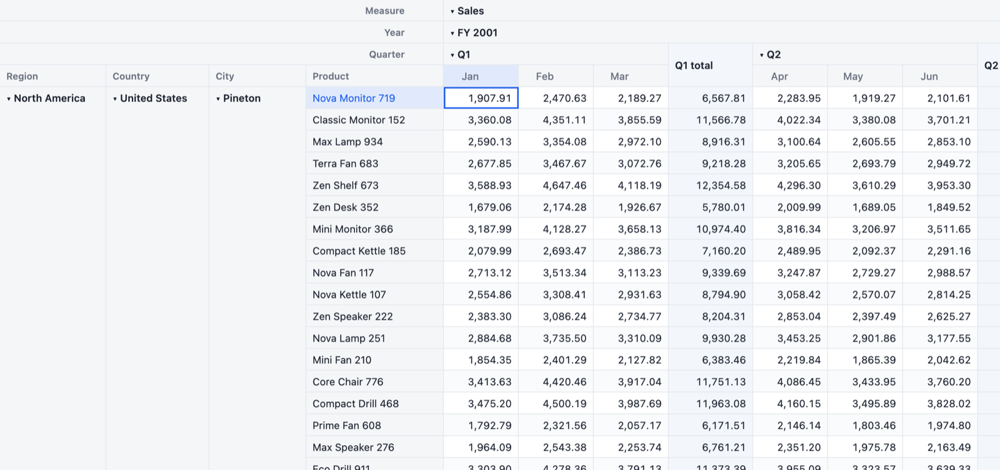

# @borealjs/react-grid

[](https://www.npmjs.com/package/@borealjs/react-grid)
[](https://github.com/borealjs/grid/blob/main/packages/react-grid/src/types.ts)
[](https://react.dev)
[](https://github.com/borealjs/grid/blob/main/LICENSE)

A React data grid that stays smooth at any size. Hand it an array, or connect a backend with a hook, and scroll
through millions of rows (billions with a server). Cells, headers, filters and the empty state are plain React
components.

**[Live demo](https://borealjs.github.io/grid/)**: a billion-row table, a pivot and React cells, right in your browser.

<picture>
  <source media="(prefers-color-scheme: dark)" srcset="https://raw.githubusercontent.com/borealjs/grid/main/media/grid-dark.png">
  
</picture>

```jsx
<VirtualGrid rows={customers} style={{ height: 600 }}>
  <Column field="name" title="Customer" />
  <Column field="status" title="Status" filter="values" renderCell={({ value }) => <Badge status={value} />} />
  <Column field="amount" title="Amount" type="number" format={(v) => money.format(v)} />
</VirtualGrid>
```

- **Your data, your way.** `rows` for data in memory, or `useDataSource` for any backend (REST, GraphQL, SQL,
  a worker). Only what is on screen is requested.
- **React all the way.** JSX columns; components in cells, headers and filters; your context providers apply;
  inline functions are fine.
- **Controlled or uncontrolled** sort, filters and selection.
- **Everything a grid needs.** Multi-column sorting, filters (ranges, dates, text, searchable value lists, your
  own), column chooser, pivots with subtotals, merged cells, range selection, copy, full keyboard support.
- **Fits your stack.** TypeScript types inferred from your row type; works with Next.js, Remix and Vite; no
  dependencies besides React.

## Contents

- [Installation](#installation)
- [Quick start](#quick-start)
- [Columns](#columns): [pinned and reordered](#pinned-and-reordered-columns)
- [Custom cells](#custom-cells)
- [Data](#data): [in memory](#in-memory-rows), [from a server](#server-data-usedatasource), [row ids](#row-ids-getrowid)
- [Sorting and filtering](#sorting-and-filtering), [slow sorts and filters](#slow-sorts-and-filters), [custom filters](#custom-filters)
- [Controlled state](#controlled-state)
- [Selection and copy](#selection-and-copy), [checkboxes](#row-checkboxes)
- [Cell events](#cell-events): click, double-click, context menu
- [Grid API (ref)](#grid-api-ref)
- [Styling and theming](#styling-and-theming), [empty state](#empty-state), [translations](#translations)
- [TypeScript](#typescript)
- [Next.js and server rendering](#nextjs-and-server-rendering)
- [Pivots](#pivots)
- [Accessibility and keyboard](#accessibility-and-keyboard)
- [Performance](#performance)
- [Recipes](#recipes)
- [API reference](#api-reference)
- [FAQ](#faq)

## Installation

```bash
npm install @borealjs/react-grid @borealjs/grid-core
# or
pnpm add @borealjs/react-grid @borealjs/grid-core
yarn add @borealjs/react-grid @borealjs/grid-core
bun add @borealjs/react-grid @borealjs/grid-core
```

Import the styles once, for example in your root layout or `main.jsx`:

```js
import '@borealjs/grid-core/style.css';
```

Works with React 18 and 19 in all current browsers.

## Quick start

```jsx
import { VirtualGrid, Column } from '@borealjs/react-grid';
import '@borealjs/grid-core/style.css';

const customers = [
  { id: 1, name: 'Ada Lovelace', status: 'Active', amount: 1200, signed: '2024-03-01' },
  { id: 2, name: 'Grace Hopper', status: 'Pending', amount: 950, signed: '2024-05-17' },
  { id: 3, name: 'Alan Turing', status: 'Active', amount: 1430, signed: '2023-11-30' },
];

export default function Customers() {
  return (
    <VirtualGrid rows={customers} style={{ height: 600 }} aria-label="Customers">
      <Column field="id" title="ID" type="number" width={80} />
      <Column field="name" title="Customer" width={220} />
      <Column field="status" title="Status" filter="values" />
      <Column field="amount" title="Amount" type="number" format={(v) => `$${v.toFixed(2)}`} />
      <Column field="signed" title="Signed" type="date" />
    </VirtualGrid>
  );
}
```

That grid already sorts (click a header; Shift+click adds a column), filters (the funnel in each header),
resizes columns, selects ranges, copies with ⌘C / Ctrl+C and works from the keyboard.

> **Important**
> The grid takes the size of its container. Give it a height with `style`, a CSS class, or make it a flex child
> with `flex: 1; min-height: 0`. If nothing shows up, this is almost always why.

## Columns

Columns can be JSX children or an array. Both take the same props.

```jsx
const columns = [
  { field: 'name', title: 'Customer', width: 220 },
  { field: 'amount', title: 'Amount', type: 'number' },
];

<VirtualGrid rows={rows} columns={columns} />
```

`field` names the row property to show. It is also the column's id in sort, filter and events. `type="number"`
aligns right and filters by range, `type="date"` filters by date range. All column props are in the
[API reference](#column).

No memoizing needed: inline arrays and functions are fine, and they always see your latest state.

```jsx
const [term, setTerm] = useState('');

<Column field="name" renderCell={({ value }) => <Highlight text={value} term={term} />} />
```

### Pinned and reordered columns

`pinned` keeps a column at the start while the rest scroll sideways. Users can drag column headers to another
place (Escape cancels); pinned columns stay together at the start.

```jsx
<VirtualGrid rows={rows} onColumnOrderChange={(order) => save('order', order)} columnOrder={savedOrder}>
  <Column field="id" title="ID" pinned />
  <Column field="name" title="Customer" pinned />
  <Column field="amount" title="Amount" type="number" />
  <Column field="actions" title="" reorderable={false} />
</VirtualGrid>
```

`onColumnOrderChange` gets the fields in their new order; pass them back as `columnOrder` to restore it.
`reorderable={false}` on the grid turns dragging off. With millions of columns, `pinnedColumns={2}`
pins the first two, and the order is compact: single indexes and `[first, last]` runs such as
`[[0, 4], 9, [5, 8], [10, 999999]]`.

## Custom cells

There are three ways to customize a cell, from lightest to most flexible:

| Prop | Use it for |
|---|---|
| `format={(value, ctx) => string}` | the text shown: currencies, dates, units |
| `cellClass={(value, ctx) => string}` | a CSS class: colors, weights |
| `renderCell={(ctx) => ReactNode}` | any React content: badges, links, buttons, charts |

```jsx
<Column field="status" renderCell={({ value }) => <span className={`badge badge-${value}`}>{value}</span>} />
<Column field="progress" type="number" renderCell={({ value }) => <ProgressBar value={value} />} />
<Column field="actions" title="" sortable={false} filter={false}
  renderCell={({ row }) => <button onClick={() => openCustomer(row.id)}>Open</button>} />
```

`renderCell` receives:

| | |
|---|---|
| `value` | the cell's value |
| `row` | the whole record (with `rows` or a `getRows` data source; `undefined` with `getCells`) |
| `text` | the value after `format` |
| `rowIndex`, `colIndex` | position on screen, after sorting and filtering |
| `rowSource`, `colSource` | position in the data source |
| `column` | the column definition |
| `grid` | the [grid API](#grid-api-ref) |

- Components in cells can use hooks and your context providers.
- Links, buttons and inputs in cells work as usual: clicking them doesn't move the selection, and typing into
  an input stays in the input. Mark other clickable elements with `data-vg-interactive`.
- `renderHeader={(ctx) => ReactNode}` customizes a header the same way.

`format`, `cellClass`, `renderCell` and `renderHeader` on `<VirtualGrid>` apply to every column that has none of
its own, and to pivots.

## Data

### In memory: `rows`

```jsx
const [rows, setRows] = useState(initialRows);

<VirtualGrid rows={rows} columns={columns} />
```

Sorting, filtering and value lists run in the browser; a million rows is fine. Text sorts naturally ("Item 2"
before "Item 10") and empty values go last. Passing a new array updates the grid in place: scroll position,
sort, filters and selection stay. Rows can be objects (`field` names a property) or arrays (columns map by
position).

### Server data: `useDataSource`

The grid never holds the whole table: it asks your callbacks only for what is on screen, and sorting, filtering
and finding rows happen on your server, so everything works the same for a thousand rows or a billion. Every
call gets an `AbortSignal`: pass it to `fetch` so requests the grid no longer needs are cancelled. The
callbacks can use props and state freely; when `deps` change, the grid reloads in place.

| | Use it for | Asks for |
|---|---|---|
| `getCells` | any size: billions of rows, millions of columns, pivots | rectangles of cells by position |
| `getRows` | the quickest start with an ordinary REST, GraphQL or SQL endpoint | pages of row objects by offset / limit |

**Cells: any size.**

```jsx
const source = useDataSource({
  // How many rows match the current filter.
  getLayout: async ({ query, signal }) => ({ rowCount: await api.count(query, signal) }),
  // The cells of one or more rectangles: { row, col, rowCount, colCount }, positions in the sorted, filtered result.
  getCells: ({ rects, query, signal }) => api.cells(rects, query, signal), // one [[a, b], [c, d]] per rect
}, [customerId]);

<VirtualGrid dataSource={source} columns={columns} aria-label="Orders" />
```

The query names columns by `field` (and index):

```js
sort: [{ key: 'total', column: 2, direction: 'desc' }],
filter: [
  { key: 'total', column: 2, op: 'range', min: 100, max: 500 },   // numbers, or dates as 'YYYY-MM-DD'
  { key: 'product', column: 1, op: 'in', values: ['Lamp'] },      // also 'notin'
  { key: 'note', column: 4, op: 'contains', text: 'urgent' },
  { key: 'score', column: 5, op: 'atLeast', value: 90 },          // custom filters
],
```

If your server implements the
[HTTP API in the core guide](https://github.com/borealjs/grid/tree/main/packages/grid-core#ready-made-sources),
`createHttpSource({ baseUrl, params, headers })` is a ready-made data source for it; the repository's
reference server serves a billion rows with it.

**Rows by offset / limit.** The quickest way in when your API already pages rows. Cells are read from each row
by `field`, and your cells and events get the whole row:

```jsx
function Orders({ customerId }) {
  const source = useDataSource({
    // Rows offset … offset + limit - 1 of the sorted, filtered result, and how many rows match.
    async getRows({ offset, limit, sort, filter, signal }) {
      const params = new URLSearchParams({ customerId, offset, limit, sort: JSON.stringify(sort), filter: JSON.stringify(filter) });
      const res = await fetch(`/api/orders?${params}`, { signal });
      return res.json(); // { rows: [{ id: 1, product: 'Lamp', total: 120 }, …], total: 48213 }
    },
  }, [customerId]);

  return (
    <VirtualGrid dataSource={source} getRowId={(row) => row.id} style={{ height: 600 }} aria-label="Orders">
      <Column field="id" title="Order" type="number" />
      <Column field="product" title="Product" filter="values" />
      <Column field="total" title="Total" type="number" />
      <Column field="actions" title="" sortable={false} filter={false}
        renderCell={({ row }) => <button onClick={() => openOrder(row)}>Open</button>} />
    </VirtualGrid>
  );
}
```

`limit` is the page size (100). With SQL, `filter` becomes a parameterized `WHERE`, `sort` an `ORDER BY` (add a
unique column last so the order is stable) and `offset` / `limit` become `OFFSET` / `LIMIT`. Map `key` to
column names through an allow-list on the server; never put client text into SQL. Know where it stops: most
databases walk past every skipped row for `OFFSET`, so pages deep into a huge table get slow, and a row object
has to carry every column. For those, use `getCells`.

Add `getFilterValues({ key, search, limit, signal })` to either shape for value-list filters
(`{ values, total, matches }`).

### Row ids: `getRowId`

With an id for each row the grid keeps track of rows, not positions: after a sort, a filter, new `rows` or
`refresh()`, the selection stays on its row, and checked rows from another sort or filter are shown where they
are now.

```jsx
<VirtualGrid rows={rows} getRowId={(row) => row.id} />
```

- In-memory rows default to the row object itself, so pass `getRowId` when you replace rows with new objects
  (as React state updates do).
- The data source finds rows with `indexOfRow(id, query)`: the position, `-1` when the row is not in that view,
  `null` when it cannot tell. In-memory rows and `createHttpSource` do it at any size; `getRows` sources find
  rows among the pages they loaded, or ask your `indexOfRow`. `getCells` sources can give ids with
  `rowIdAt(position, query)`.
- When the selected row is gone, or the source cannot tell where it went, the selection moves to the first row
  and a notice says so. Reword it with `messages={{ selectionRowGone, selectionNotFollowed }}`;
  `onSelectionChange` reports `moved: 'rowGone' | 'notFollowed'`. Without row ids a sort or filter does the same,
  and a refresh keeps the position.

## Sorting and filtering

Click a header to sort (▲, ▼, off); Shift+click adds it to the sort. `sortable={false}` turns sorting off for
the grid or a column, and `multiSort={false}` allows one sorted column at a time.

Each column gets a filter dialog from its `filter` prop, or else from its `type`:

| Column | Dialog |
|---|---|
| `filter="values"` | checkbox list with search: the values from `rows`, or from your server's `getFilterValues` |
| `filter={{ type: 'values', values: [...] }}` | checkbox list of the values you give |
| `filter="text"`, or no `type` | "contains" |
| `type="number"` or `filter="number"` | min and max |
| `type="date"` or `filter="date"` | from and to |
| `filter={{ op, render }}` | your component ([custom filters](#custom-filters)) |
| `filter={false}` | no filter |

Value lists show at most 1,000 values; beyond that the dialog asks the user to refine the search. They suit
columns with a modest set of repeated values (status, city, owner); text search suits near-unique ones (names,
codes).

To decide in one place what can be sorted or filtered, including pivot levels, pass a function. It is asked
about each column (`{ axis: 'cols', column, key }`) and level (`{ axis: 'rows' | 'cols', level }`):

```jsx
<VirtualGrid
  dataSource={source}
  sortable={(target) => target.key !== 'notes'}
  filterable={(target) => target.axis !== 'rows' || target.level < 2}
/>
```

### Slow sorts and filters

When a sort or filter takes more than a moment, the grid shows what it is doing with a Cancel button. The
request that applies it (`getRows` for the first page, or `getLayout`) receives `onProgress` to say how far it
is, and cancelling aborts its `signal`:

```jsx
const source = useDataSource({
  async getRows({ offset, limit, sort, filter, signal, onProgress }) {
    const job = await api.startQuery({ sort, filter }, { signal });
    while (!job.done) {
      onProgress?.({ phase: 'Checking rows', done: job.checked, total: job.rows });
      await job.next();
    }
    return job.page(offset, limit); // { rows, total }
  },
});
```

`grid.current.cancel()` stops it from code; `onViewChange` reports `{ pending: true, progress }` and
`{ cancelled: true }`.

If your backend can't sort or filter very large tables at all, return `maxSortRows` / `maxFilterRows` from
`getLayout` (with `getCells`). The grid then explains the limit to the user instead of sending requests that would fail.

### Custom filters

A custom filter is a component. It receives `{ value, setValue, apply, clear, close, column, title }`, and the
dialog's Apply button sends the value you set.

```jsx
function MinScore({ value, setValue }) {
  const [min, setMin] = useState(value ?? 50);
  useEffect(() => setValue(min), [min, setValue]);
  return <input type="range" min={0} max={100} value={min} onChange={(e) => setMin(+e.target.value)} />;
}

<VirtualGrid rows={rows} filterFns={{ atLeast: (cellValue, min) => cellValue >= min }}>
  <Column field="score" type="number" filter={{ op: 'atLeast', render: (api) => <MinScore {...api} /> }} />
</VirtualGrid>
```

With `rows`, `filterFns[op](cellValue, value, row)` decides which rows stay. A server receives
`{ key: 'score', op: 'atLeast', value: 72 }` in the query's filter list.

## Controlled state

Pass a value to control it; leave it out to let the grid keep it (`defaultSort` and friends set where it
starts).

```jsx
const [sort, setSort] = useState([{ key: 'amount', direction: 'desc' }]);
const [filter, setFilter] = useState([]);

<VirtualGrid rows={rows} columns={columns}
  sort={sort} onSortChange={setSort}
  filter={filter} onFilterChange={setFilter} />

<button onClick={() => setFilter([])}>Clear filters</button>
```

| Value | Change event | Uncontrolled starting value |
|---|---|---|
| `sort` | `onSortChange` | `defaultSort` |
| `filter` | `onFilterChange` | `defaultFilter` |
| `columnFilter` | `onColumnFilterChange` | `defaultColumnFilter` |
| `selectedCells` | `onSelectionChange` | |

Values are compared by content, so a new array with the same items changes nothing. Sort and filter items may
name a column by `key` (its field) or `column` (its index).

## Selection and copy

Click, Shift+click, drag, ⌘/Ctrl+click to add ranges, ⌘/Ctrl+A to select all. ⌘C / Ctrl+C copies the selection
as tab-separated text (it pastes into Excel and Google Sheets) and as an HTML table, loading cells that are not
on screen first.

```jsx
<VirtualGrid selection="single" onSelectionChange={(s) => setActive(s.active)} />  {/* 'multi' | 'single' | 'none' */}
<VirtualGrid onCopy={(info) => toast(`Copied ${info.cells} cells`)} />
```

`onSelectionChange` receives `{ active: { r, c }, ranges, text, rows, cols, cells }`. To control the selection,
pass `selectedCells={{ active, ranges }}`.

### Row checkboxes

`rowSelection` adds a checkbox to each row number; the one in the corner checks every row. Shift+click checks
a range, and Space checks the active row.

```jsx
const grid = useRef(null);
const [checked, setChecked] = useState({ checks: [] });

<VirtualGrid ref={grid} rows={rows} getRowId={(row) => row.id} rowSelection selectedRows={checked} onRowSelectionChange={setChecked} />
<span>{grid.current?.checkedCount() ?? 'Some'} checked</span>
```

Checked rows are steps in the order they were made; the last step covering a row decides:

```js
{ checks: [
  { from: 0, to: 49_999_999, query, checked: true },   // Shift+click: rows 1 to 50,000,000 of that sort / filter
  { id: 812, checked: false },                         // then one row unchecked
] }
```

A range costs the same for 10 rows or 50 million and needs no rows loaded, so checking works the same at any
size, and memory grows with clicks, not rows. Your server can act on the same steps to delete or export what is
checked. `checkedCount()` counts them when it can without the server. Rows checked in another sort or filter
are placed through `indexOfRow`; if that is not possible a notice says so (`messages.checksNotShown`) and they
stay checked.

## Cell events

```jsx
<VirtualGrid
  rows={rows}
  onCellClick={({ row, key, value }) => setDetail(row)}
  onCellDoubleClick={({ row }) => openEditor(row)}
  onCellContextMenu={({ row, event }) => {
    event.preventDefault();               // instead of the browser's menu
    showMenu(event.clientX, event.clientY, row);
  }}
/>
```

Each event gets the cell's [context](#custom-cells) (`row`, `value`, `text`, `rowIndex`, `column`, …), its
`key` and the DOM `event`. A right click outside the selection selects the cell first, and the context-menu key
(or Shift+F10) opens the menu for the active cell. Clicks on links, buttons and inputs in cells are theirs, not
cell clicks.

## Grid API (ref)

```jsx
const grid = useRef(null);

<VirtualGrid ref={grid} rows={rows} columns={columns} />
<button onClick={() => grid.current.scrollToCell(5000, 0)}>Go to row 5,000</button>
```

The most used methods are `scrollToCell(row, col)`, `refresh()` (the server's data changed), `toggleSort(field)`,
`openFilter(field)`, `getQuery()`, `getSelection()` and `copySelection()`. The full list is in the
[API reference](#grid-api).

## Styling and theming

```jsx
<VirtualGrid className="my-grid" style={{ height: '70vh' }} theme="dark" />  {/* 'auto' (default) | 'light' | 'dark' */}
```

`theme="auto"` follows the system's light or dark mode. Colors, fonts and lines are CSS variables, so the grid
fits any design system (with Tailwind, set them in your CSS or with arbitrary properties):

```css
.my-grid .vg {
  --vg-bg: #ffffff;
  --vg-fg: #111827;
  --vg-muted: #6b7280;
  --vg-line: #e5e7eb;
  --vg-head: #f9fafb;
  --vg-zebra: #fcfcfd;
  --vg-accent: #7c3aed;
  --vg-sel-fill: rgb(124 58 237 / 0.1);
  --vg-font: 14px/1.4 Inter, sans-serif;
}
```

Sizes are props (`rowHeight`, `headerHeight`, `columnWidth`), and `rowClass`, `cellClass`, `className` and
`headerClass` add your own classes. The row-number column is `rowHeader={{ width, title, label }}`, or
`rowHeader={false}` to hide it.

### Empty state

```jsx
<VirtualGrid rows={rows} emptyState={({ filtered }) => filtered
  ? <p>No matches. <button onClick={() => setFilter([])}>Clear filters</button></p>
  : <EmptyIllustration />} />
```

### Translations

Every text the grid shows is in `messages`. Pass the ones you want to change:

```jsx
<VirtualGrid messages={{
  noRows: 'Keine Zeilen',
  apply: 'Anwenden',
  clear: 'Zurücksetzen',
  searchValues: (n) => `${n ?? ''} Werte durchsuchen`,
}} />
```

`DEFAULT_MESSAGES` from `@borealjs/grid-core` has the full list with the English texts.

## TypeScript

Types come from your row type:

```tsx
type Customer = { id: number; name: string; amount: number; status: 'Active' | 'Closed' };

<VirtualGrid<Customer> rows={customers} onSortChange={(sort) => setSort(sort)}>
  <Column<Customer, 'amount'> field="amount" format={(v) => v.toFixed(2)} />  {/* v: number */}
</VirtualGrid>
```

For column arrays, `createColumnHelper` types each value exactly:

```tsx
import { createColumnHelper, type ColumnDef } from '@borealjs/react-grid';

const col = createColumnHelper<Customer>();

const columns: ColumnDef<Customer>[] = [
  col.field('name', { title: 'Customer' }),
  col.field('amount', { type: 'number', format: (v) => v.toFixed(2) }),          // v: number
  col.field('status', { renderCell: ({ value }) => <Badge status={value} /> }),  // value: 'Active' | 'Closed'
  col.computed('label', (r) => `${r.name} #${r.id}`, { title: 'Label' }),        // value: string
];
```

Type the ref as `GridApi`: `useRef<GridApi>(null)`.

## Next.js and server rendering

The package is marked `'use client'`. Render `<VirtualGrid>` from a Server Component when every prop is
serializable (`rows`, column props without functions); when you pass functions such as `renderCell`, wrap it in
your own client component. On the server the grid renders an empty container that fills in once the page loads.

```tsx
// app/customers/page.tsx (a Server Component)
import { CustomersGrid } from './customers-grid'; // a 'use client' component with your renderCell etc.

export default async function Page() {
  return <CustomersGrid rows={await db.customers.findMany()} />;
}
```

## Pivots

Connect a data source whose `getLayout` returns a pivot layout (see
[Pivots in the core guide](https://github.com/borealjs/grid/tree/main/packages/grid-core#pivots)) and the grid
draws grouped row and column headers, subtotals and expand/collapse. `grid.current.showLevel('rows', 1)`
collapses to a level and `grid.current.expandAll('rows')` opens everything again.

```jsx
const pivot = useMemo(() => createHttpSource({ baseUrl: '/api', params: { mode: 'pivot' } }), []);

<VirtualGrid dataSource={pivot} aria-label="Sales by region" onReady={(g) => setLevels(g.levels)} />
```

## Accessibility and keyboard

The grid follows the WAI-ARIA grid pattern: one tab stop, with row and column counts, selection, sort and
expanded state announced to screen readers. Name it with `aria-label`. <kbd>Ctrl</kbd> is <kbd>⌘</kbd> on macOS.

| Keys | Action |
|---|---|
| <kbd>←</kbd> <kbd>→</kbd> <kbd>↑</kbd> <kbd>↓</kbd> | Move to the next cell |
| <kbd>Ctrl</kbd>+arrow | Jump to the first or last row or column |
| <kbd>Home</kbd> / <kbd>End</kbd> | First or last cell of the row |
| <kbd>Ctrl</kbd>+<kbd>Home</kbd> / <kbd>Ctrl</kbd>+<kbd>End</kbd> | First or last cell of the grid |
| <kbd>Page Up</kbd> / <kbd>Page Down</kbd> | Move by one screen |
| <kbd>Shift</kbd>+any of the above | Extend the selection |
| <kbd>Enter</kbd> / <kbd>Shift</kbd>+<kbd>Enter</kbd> | Next or previous cell; inside a selection, cycle through it |
| <kbd>Ctrl</kbd>+<kbd>A</kbd> | Select all |
| <kbd>Ctrl</kbd>+<kbd>C</kbd> | Copy the selection |
| <kbd>Escape</kbd> | Reduce the selection to the active cell |
| <kbd>Alt</kbd>+<kbd>S</kbd> | Sort by the active column (<kbd>Shift</kbd> adds it to the sort) |
| <kbd>Alt</kbd>+<kbd>F</kbd> | Open the active column's filter |
| <kbd>Alt</kbd>+<kbd>Shift</kbd>+arrow | Collapse or expand a pivot group |

## Performance

The grid stays fast with any amount of data. A few habits keep your own code from slowing it down.

**Use `format` for plain text.** It is much lighter than a component.

```jsx
// ✅ Good
<Column field="amount" format={(v) => money.format(v)} />

// ❌ Avoid: a React component per cell just to show text
<Column field="amount" renderCell={({ value }) => <>{money.format(value)}</>} />
```

**Derive rows with `useMemo`.** A new `rows` array tells the grid the data changed, so it sorts and filters
again.

```jsx
// ✅ Good: a new array only when the data or the search changes
const visible = useMemo(() => orders.filter((o) => o.region === region), [orders, region]);
<VirtualGrid rows={visible} />

// ❌ Avoid: a new array on every render
<VirtualGrid rows={orders.filter((o) => o.region === region)} />
```

**Keep column titles, types, widths and filters steady.** Changing one redraws the whole grid (scroll, sort and
filters are kept). Functions can change freely.

```jsx
// ❌ Avoid: the title changes on every update of `count`
<Column field="name" title={`Customers (${count})`} />
```

**Keep cell components light.** Load data for the grid through the data source, not inside cells.

**With `getColumn`** (thousands of columns), wrap the function in `useCallback`.

## Recipes

**Search box over server data**

```jsx
const [search, setSearch] = useState('');
const deferred = useDeferredValue(search);  // or your own debounce hook
const source = useDataSource({
  getRows: ({ offset, limit, sort, filter, signal }) => api.orders({ search: deferred, offset, limit, sort, filter }, signal),
}, [deferred]);
```

**Cache with TanStack Query**

```jsx
const queryClient = useQueryClient();
const source = useDataSource({
  getRows: ({ offset, limit, sort, filter, signal }) => queryClient.fetchQuery({
    queryKey: ['orders', offset, limit, sort, filter],
    queryFn: () => api.orders({ offset, limit, sort, filter }, signal),
    staleTime: 60_000,
  }),
});
```

**Refresh after saving**

```jsx
await api.updateOrder(id, patch);
grid.current.refresh();                 // server data
setRows((rows) => rows.map((r) => (r.id === id ? { ...r, ...patch } : r)));  // in-memory rows
```

**Row actions** (in-memory rows or a `getRows` data source)

```jsx
<Column field="actions" title="" width={120} sortable={false} filter={false} reorderable={false}
  renderCell={({ row }) => <RowMenu onEdit={() => edit(row)} onDelete={() => remove(row.id)} />} />
```

## API reference

### `<VirtualGrid>`

#### Data

| Prop | Type | Default | |
|---|---|---|---|
| `rows` | `Row[]` | | data in memory |
| `dataSource` | `DataSource` | | or your backend ([server data](#server-data-usedatasource)) |
| `getRowId` | `(row) => string \| number` | in-memory: the row itself | stable row ids ([row ids](#row-ids-getrowid)) |
| `columns` | `ColumnDef<Row>[]` | | or `<Column>` children |
| `columnCount`, `getColumn` | `number`, `(index) => ColumnDef` | | instead of `columns`, for thousands of columns (or let the data source describe them: `getColumns`) |
| `rowCount` | `number` | | row count when the data source has no `getLayout` |
| `filterFns` | `{ [op]: (cellValue, value, row) => boolean }` | | custom filter operators for `rows` |

#### Features

| Prop | Type | Default | |
|---|---|---|---|
| `sortable` | `boolean \| (target) => boolean` | `true` | a function decides per column or level |
| `multiSort` | `boolean` | `true` | Shift+click adds columns to the sort |
| `filterable` | `boolean \| (target) => boolean` | `true` | a function decides per column or level |
| `resizable` | `boolean` | `true` | |
| `expandable` | `boolean` | `true` | expand and collapse pivot groups |
| `selection` | `'multi' \| 'single' \| 'none'` | `'multi'` | |
| `copy` | `boolean` | `true` | ⌘C / Ctrl+C |
| `keyboard` | `boolean` | `true` | |
| `notices` | `boolean` | `true` | short messages in the grid: copies, and slow, refused or failed sorts and filters |
| `columnChooser` | `boolean` | on when columns have a `group` | a corner menu to show and hide column groups |
| `rowSelection` | `boolean` | `false` | [row checkboxes](#row-checkboxes) |
| `pinnedColumns` | `number` | columns marked `pinned` | pin this many leading columns |
| `reorderable` | `boolean` | `true` | drag column headers to reorder |

#### Look

| Prop | Type | Default | |
|---|---|---|---|
| `className`, `style`, `id` | | | on the grid's container |
| `aria-label` | `string` | | the grid's name for screen readers |
| `theme` | `'auto' \| 'light' \| 'dark'` | `'auto'` | |
| `rowHeight` | `number` | `28` | px |
| `headerHeight` | `number` | `34` | px |
| `columnWidth` | `number` | `132` | px, for columns without `width` |
| `minColumnWidth` | `number` | `48` | px |
| `rowHeader` | `false \| { width, title, label(row) }` | row numbers | |
| `rowClass` | `(rowIndex) => string` | | |
| `format`, `cellClass`, `renderCell`, `renderHeader` | | | for columns without their own |
| `emptyState` | `ReactNode \| ({ filtered }) => ReactNode` | "No rows" | |
| `messages` | `Partial<Messages>` | English | |

#### State

| Prop | Type | |
|---|---|---|
| `sort`, `defaultSort` | `SortItem[]` | controlled, or the starting value |
| `filter`, `defaultFilter` | `FilterItem[]` | |
| `columnFilter`, `defaultColumnFilter` | `ColumnFilterItem[]` | which column groups are shown |
| `selectedCells` | `{ active, ranges }` | controlled selection |
| `selectedRows` | `{ checks: RowCheck[] }` | checked rows |
| `columnOrder` | `string[]` | column fields in display order (compact runs with `getColumn`) |

#### Events

| Prop | Receives |
|---|---|
| `onSortChange` | `SortItem[]` |
| `onFilterChange` | `FilterItem[]` |
| `onColumnFilterChange` | `ColumnFilterItem[]` |
| `onSelectionChange` | `{ active, ranges, text, rows, cols, cells }` |
| `onCopy` | `{ ok, cells, rows, cols, ms, reason? }` |
| `onColumnResize` | `{ column, key, width }`, when the user lets go |
| `onColumnOrderChange` | fields in their new order, after a drag |
| `onRowSelectionChange` | `{ checks }` |
| `onCellClick`, `onCellDoubleClick`, `onCellContextMenu` | the cell's context plus `key` and `event` ([cell events](#cell-events)) |
| `onViewChange` | `{ what, pending, progress? }` while a sort or filter runs, then `{ what, ok, rows, reason? }` or `{ what, cancelled: true }` |
| `onError` | `(error, { kind: 'layout' \| 'cells' \| 'labels' })`; errors are logged when this is not set |
| `onReady` | `(grid)` once the grid is drawn |

### `<Column>`

The same props work in a `columns` array.

| Prop | Type | |
|---|---|---|
| `field` | `string` | the row property, and the column's id in sort, filter and events (alias: `key`) |
| `title` | `string` | header text |
| `type` | `'text' \| 'number' \| 'date'` | alignment and the default filter |
| `width` | `number` | px |
| `align` | `'start' \| 'end' \| 'center'` | |
| `filter` | see [sorting and filtering](#sorting-and-filtering) | |
| `sortable`, `resizable`, `hidden` | `boolean` | |
| `pinned` | `boolean` | stays at the start while scrolling sideways |
| `reorderable` | `boolean` | `false`: cannot be dragged elsewhere |
| `group` | `string` | group name for the column chooser |
| `format` | `(value, ctx) => string` | text shown in the cell |
| `cellClass` | `(value, ctx) => string` | a class per cell |
| `className`, `headerClass` | `string` | classes for every cell, or the header |
| `renderCell` | `(ctx) => ReactNode` | your own cell content |
| `renderHeader` | `(ctx) => ReactNode` | your own header content |
| `value` | `(row) => any` | a computed value (with `rows`) |
| `compare` | `(a, b) => number` | a custom sort order (with `rows`) |

### Grid API

What the `ref` gives you.

| Method | |
|---|---|
| `scrollToCell(row, col?)` | bring a cell into view |
| `refresh()` | reload the visible data (it changed on the server) |
| `getRow(rowIndex)` | the record behind a visible row, when loaded |
| `getRowSelection()`, `setRowSelection(sel)`, `checkedCount()` | checked rows |
| `getColumnOrder()`, `setColumnOrder(fields)` | column order |
| `getQuery()`, `getSort()`, `getFilter()`, `getColumnFilter()` | the current sort and filters |
| `setSort(sort)`, `setFilter(filter)`, `setColumnFilter(list)` | change uncontrolled state; resolve to `false` if refused |
| `toggleSort(field, additive?)` | what a header click does |
| `openFilter(field)`, `closeFilter()` | the filter dialog |
| `cancel()` | stop a sort or filter that is still running |
| `getSelection()`, `setSelection(sel)`, `selectAll()`, `selectionInfo()` | selection |
| `copySelection()` | copy, as with ⌘C / Ctrl+C |
| `cellValue(row, col)`, `cellText(row, col)` | a loaded cell's value or text |
| `setColumnWidth(col, px)` | |
| `setMerges(merges)` | merged cells: `[{ r0, c0, nr, nc, label? }]` |
| `rowCount`, `columnCount`, `visibleRange` | sizes and what is on screen |
| `levels`, `showLevel(axis, level)`, `expandAll(axis)`, `toggleGroup(axis, level, group)` | pivots |
| `focus()` | |

### Hooks and helpers

| | |
|---|---|
| `useDataSource(callbacks, deps)` | a data source from callbacks; when `deps` change, the grid reloads in place |
| `useArraySource(rows, options)` | an in-memory data source you can share or pass as `dataSource` |
| `createColumnHelper<Row>()` | typed column definitions ([TypeScript](#typescript)) |
| `createArraySource`, `createRowSource`, `createHttpSource` | the [ready-made sources](https://github.com/borealjs/grid/tree/main/packages/grid-core#ready-made-sources) from the core package |

## FAQ

**Nothing shows up.** Give the grid a height (see [Quick start](#quick-start)).

**Can users edit cells?** Not built in yet. Render an input with `renderCell`, save the change, then update
`rows` or call `refresh()`.

**Can I export to Excel?** Copying a selection pastes straight into Excel and Google Sheets. File export is not
built in.

**Clicking a button in a cell selects the cell.** Links, buttons and form fields are handled for you; add
`data-vg-interactive` to other clickable elements.

**How do I show 10,000+ columns?** Don't list them: return `columnCount` from `getLayout` and add
`getColumns({ start, count, query, signal })` to the data source. It describes the columns coming into view
(`[{ key, title, type, filter, width, group }]`), so a million distinct columns keep their types, filters and
widths without being sent up front, and the column chooser (`columnChooser`) asks the server for groups.
Functions such as `format` or `renderCell` still come from `getColumn(index)` in code, which wins over the
description. `createHttpSource` supports it when the server sends `columns: true` in `meta`.

**Can I use it without React?** Yes: [`@borealjs/grid-core`](https://www.npmjs.com/package/@borealjs/grid-core)
has the same features with a plain JavaScript API.

## License

[MIT](https://github.com/borealjs/grid/blob/main/LICENSE)
